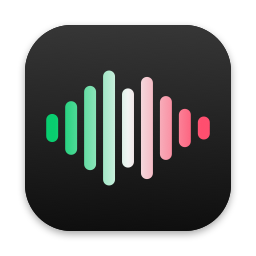

<p align="center"></p>

# Lipsync

Use Spotify the way you always do: search, playlists, radio, DJ, recommendations. Every song
plays from Apple Music in the Music app instead, with Lossless, Hi-Res Lossless, Dolby Atmos,
your EQ and Sound Check.

Spotify lip-syncs, Apple Music sings.

Lipsync is unofficial and not affiliated with Spotify or Apple. It relies on private macOS
interfaces (MediaRemote), so a macOS update can break it.

## What it does

- **Spotify keeps playing, silently.** Lipsync mutes Spotify at the system audio level with a
  Core Audio process tap. Spotify's own volume stays where it was and it plays every track in
  real time, so its listening history, recommendations, Discover Weekly and DJ see an ordinary
  listen.
- **The Music app plays the same song.** Lipsync starts it the way Siri and Handoff do, by
  Apple Music store ID, so it's the real Music app doing the playing, with all of its features.
  No Apple Developer account is needed.
- **No gaps between songs.** Lipsync reads Spotify's upcoming queue and puts the next song in
  Music's Up Next before the current one ends, so Music changes songs on its own, gaplessly.
- **Songs you click start fast.** Songs are matched once and remembered. The playlist or album
  you're playing, your Liked Songs and your playlists are matched ahead of time in the
  background.
- **Media keys work.** Play/pause, next, scrubbing from the keyboard, Control Center or AirPods
  work whichever app macOS sends them to. Lipsync mirrors the change to the other app.
- **Anything Apple Music doesn't have plays from Spotify:** podcasts, audiobooks, ads, and songs
  missing from the catalog. A small notice says so.
- **You won't see it.** There's no Dock icon and no menu bar item for Lipsync itself; the Music
  app runs hidden in the background. Problems show up as a small pill at the bottom of the
  screen. Open Lipsync again to see what's playing, turn it off, or quit. Quitting hands the
  audio straight back to Spotify.

## What you need

- macOS 14.2 or later (tested on macOS 26.5)
- Xcode or the Command Line Tools (`xcode-select --install`) to build it
- An Apple Music subscription, signed in to the Music app
- The Spotify desktop app (Premium for DJ)
- Optional, for gapless song changes: a free Spotify developer app (step 1 below)

## Setup (once, about 5 minutes)

1. **Spotify developer app.** At developer.spotify.com/dashboard, create an app. Set the
   redirect URI to `http://127.0.0.1:47821/callback` and tick Web API. Copy its Client ID. If
   sign-in later says your user isn't registered, add your Spotify email under the app's User
   Management. This is what lets Lipsync see Spotify's queue; without it, songs still play from
   Apple Music, with a short pause between them.
2. **Build.** Clone this repo and run `scripts/build.sh --install`. That builds `Lipsync.app`, copies it to
   Applications and opens it. (You can put the Client ID in `config.env` first, copied from
   `config.example.env`, or paste it during setup.) The first build creates a local
   code-signing identity in your keychain, so macOS remembers Lipsync's permissions when you
   rebuild.
3. **Allow four things** in the setup window:
   - control of Music
   - control of Spotify
   - audio recording (this is how Spotify gets muted; nothing is recorded or saved)
   - your Spotify account

   Click Done. Lipsync opens at login from then on.

### Recommended settings

- **Spotify:** turn off Crossfade and Automix (Settings → Playback). They start the next song
  early, which would cut off the end of the Apple Music song. Streaming quality can go to Low:
  Spotify is silent, and it doesn't affect recommendations.
- **Music:** Settings → Playback → Audio Quality → Lossless, and Dolby Atmos → Automatic. In Up
  Next, turn off Autoplay (∞) so Music never adds songs of its own.

## First-run checklist

Check these the first time. `tail -f ~/Library/Logs/Lipsync/Lipsync.log` shows what it's
doing.

1. With the Music app open, run
   `/Applications/Lipsync.app/Contents/MacOS/Lipsync --play-in-music` in Terminal. Music should
   start Bohemian Rhapsody within a second or two, and the command reports what Music is
   playing. This is the exact mechanism Lipsync uses; if it fails, nothing else will work, and
   the output says why.
2. Play a song in Spotify. You hear it from Music within about a second, and the log shows
   `Matched …` then `Apple Music: …`. Spotify's progress bar keeps moving.
3. Let a song end. The next one starts with no gap, and Spotify moves on to the same song.
4. Press pause and play on the keyboard, then skip with the keyboard's next key. Both apps
   follow.
5. Scrub in Spotify. Music jumps to the same spot.
6. Play a podcast. You hear Spotify.
7. Quit Lipsync. Spotify is audible again at its usual volume.

`Lipsync --match "Title" "Artist" "Album" seconds` shows how a track would be matched, if a song
plays the wrong version or none at all.

## Good to know

- **Music's Up Next belongs to Lipsync** while Spotify plays: it holds the current song and the
  next one, and Lipsync rewrites it as Spotify's queue changes.
- **Matching** goes through Apple's public search, by title, artist, length and album. Anything
  that looks like a different version (live, remix, edit, acoustic, karaoke) is left to
  Spotify rather than play the wrong recording. Apple allows about 20 searches a minute, so the
  song you click always goes first and background matching waits its turn. Each song is looked
  up once and remembered.
- **Starting a song you just clicked** takes one lookup (unless it's already matched) plus the
  Music app's start, about a second all told. Natural song changes are gapless.
- **Different lengths:** if the Apple Music release is a little longer, it plays to its real
  end and Spotify waits on the next song. If it's shorter, Spotify is moved to the end of its
  track so it records a full listen rather than a skip.
- **Spotify DJ:** the songs DJ picks play from Apple Music. The DJ's voice is Spotify audio, so
  it's muted along with the rest of Spotify.
- **Spotify Connect:** when Spotify plays on another device, Lipsync keeps this Mac quiet.
- **Apple Music history:** these plays also count as Apple Music listens (Replay and so on).
- **Storefront:** matching uses your Mac's region. If your Apple Music account is in another
  country, set it: `defaults write app.lipsync.Lipsync storefront gb`.

## Troubleshooting

The log is at `~/Library/Logs/Lipsync/Lipsync.log`.

| Notice | Fix |
| --- | --- |
| Lipsync can't control Music / Spotify | System Settings → Privacy & Security → Automation → Lipsync: turn on Music and Spotify. |
| Muting Spotify with its volume slider | Audio recording is off for Lipsync: System Settings → Privacy & Security → Screen & System Audio Recording → System Audio Recording Only. |
| Apple Music couldn't play this song | Music refused the song (region, or not streamable). It plays from Spotify; `--play-in-music <id>` reproduces it. |
| Connect Spotify for gapless playback | Open Lipsync and click Connect Spotify. |

To start over: `defaults delete app.lipsync.Lipsync` and delete
`~/Library/Application Support/Lipsync`.

## Optional: MusicKit instead of the Music app

With an Apple Developer Program account you can build Lipsync to play through MusicKit inside
Lipsync rather than through the Music app (`LIPSYNC_BACKEND=musickit` in `config.env`). Register
`BUNDLE_ID` as an App ID with MusicKit checked under App Services, and sign with that team's
Apple Development certificate. This path matches by ISRC. The Music app path is the default
because it needs no account and keeps every Music feature.

## How it's built

| Piece | Job |
| --- | --- |
| `LipsyncCore/SyncEngine.swift` | The state machine. Spotify decides what plays; Apple Music is the clock. Each command is tracked as pending, so a change the engine caused is never mistaken for one the user made. |
| `LipsyncCore/Matcher.swift` | Matches Spotify tracks to Apple Music songs. |
| `Lipsync/Music` | The Music app player: MediaRemote for starting songs and filling Up Next, AppleScript for transport and position, and the iTunes Search catalog. |
| `Lipsync/Spotify` | AppleScript control, the playback-state notification plus polling, Web API (queue), PKCE sign-in. |
| `Lipsync/Audio/SpotifyMuter.swift` | The Core Audio process tap that silences Spotify. |
| `Lipsync/MusicKit` | The optional MusicKit backend. |
| `Lipsync/UI` | The notice pill and the setup window. |

`swift test` runs the matcher tests and 40 sync scenarios against a virtual-time simulator of
both players, with realistic latencies: gapless playlists, mismatched song lengths, clicks while
loading and in the last seconds of a song, rapid skipping, media keys on either side, scrubbing,
missing songs, podcasts, ads, buffering stalls, clock drift, lost notifications, stale queue
predictions, failed queue edits and skips, Music's AutoPlay, and Spotify Connect.

With only the Command Line Tools installed, point `swift test` at their testing framework:

```bash
F=/Library/Developer/CommandLineTools/Library/Developer/Frameworks
swift test -Xswiftc -F$F -Xlinker -F$F -Xlinker -rpath -Xlinker $F \
  -Xlinker -rpath -Xlinker /Library/Developer/CommandLineTools/Library/Developer/usr/lib
```

## License

MIT. See [LICENSE](LICENSE).
